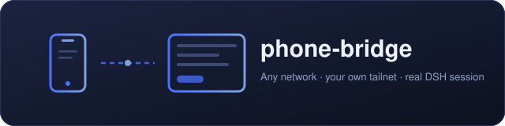

<p align="center">
  
</p>

<h1 align="center">📱 phone-bridge</h1>

<p align="center"><strong>v1.1.0</strong></p>

<p align="center">
  <em>用手机跟电脑上的 DSH 对话：发文字、拍照、传图，回复实时回显。不同 Wi-Fi 也能用。</em>
</p>

<p align="center">
  <a href="https://github.com/chs-1108/dsh-phone-bridge/stargazers"></a>
  <a href="https://github.com/chs-1108/dsh-phone-bridge/blob/main/LICENSE"></a>
  <a href="https://awesome-dsh-plugin.com"></a>
  <a href="https://www.deepseek.com/harness/"></a>
  <br>
  
  
  
</p>

<p align="center">
  <a href="README.md">English</a> | <a href="README.zh-CN.md">中文</a>
</p>

> **官方 Web 版和官方桌面端都支持。** `dsh web` 用 profile `web`；官方桌面 EXE（DeepSeek Harness **0.2.0-rc.2**）用 profile `desktop`，两边分别安装、分别生效。
>
> **没有公网服务器，没有第三方中转。** 手机和电脑在你的 Tailscale 账号所建的 WireGuard 私有网络里会合，不向公网暴露任何东西。
>
> Node.js **≥18**。原生 App 需要 Android **7.0（API 24）** 以上；任意现代浏览器也能用。

## 目录

- [这是什么](#这是什么)
- [亮点](#亮点)
- [环境要求](#环境要求)
- [最快的方式：双击安装](#最快的方式双击安装)
- [下载与安装的完整流程](#下载与安装的完整流程)
- [安装](#安装)
- [手动安装](#手动安装)
- [手机端](#手机端)
- [实现原理](#实现原理)
- [隐私](#隐私)
- [排错](#排错)
- [开发](#开发)
- [许可](#许可)

---

## 这是什么

**phone-bridge** 是官方 [DeepSeek Harness](https://www.deepseek.com/harness/) 的插件，把 DSH 会话装进手机。手机打开一个小网页（或原生 Android 外壳），发文字和照片到真实的 DSH 会话，实时读到 Agent 的回复。

```
手机（WebView / 浏览器）
   │  HTTP over Tailscale —— WireGuard 加密，点对点
   ▼
DSH webServer  ──▶  /phone-bridge 前缀路由  ──▶  sessionController  ──▶  模型
```

只消费 DSH 公开的 `webServer` 和 `sessionController` 两个服务，不改核心、不 fork 宿主。

## 亮点

- **跨网络可用** —— 手机不需要和电脑同一个 Wi-Fi。两端各加入同一个 Tailscale tailnet，各拿一个固定的 `100.x.y.z` 地址，在 Wi-Fi 和移动网络之间切换时 URL 都不变。
- **真实会话，不是旁路** —— 消息落到正常 DSH 会话里。可以用 `/api/prefs` 钉到任意会话，也可以让它惰性创建并复用。
- **流式回复** —— 插件订阅 `sessionController.follow({assistantStream: true})`，手机轮询增量结果，长回答边写边出。
- **拍照与相册** —— 原生外壳把 `onShowFileChooser` 接进系统选择器并带相机入口，照片经 `MediaStore` 写入，再交给 WebView 一个可读 URI。每条消息最多 8 张图。
- **不用 App 也能用** —— 纯浏览器方案：打开 URL、发文字、选图片即可。
- **一键部署** —— `setup-phone-bridge.ps1` 装 Tailscale、改监听、注册插件、构建 APK，并通过 USB 把两个 App 推进手机。只需要你自己的 Tailscale 账号。
- **不需要 Gradle** —— APK 直接由 `aapt2` + `d8` + `zipalign` + `apksigner` 构建，约十秒出包。

## 环境要求

| | |
| --- | --- |
| **DSH** | 0.2.0 以上，桌面 EXE 或 `dsh web` |
| **Node.js** | ≥ 18 |
| **宿主系统** | Windows 10/11（部署脚本是 PowerShell） |
| **手机** | Android 7.0+ 装 APK，或任意现代浏览器 |
| **账号** | 你自己的免费 [Tailscale](https://login.tailscale.com/start) 账号 |

可选，仅构建 APK 时需要：JDK 17 和 Android SDK build-tools 34.0.0。可选，仅 USB 推送到手机时需要：`adb`。

## 最快的方式：双击安装

下载仓库后，双击 **`安装.cmd`**，会弹出一个窗口，然后跟着走。

整个过程只有两次需要你操作：

1. **登录 Tailscale** —— 浏览器会自动打开，用你自己的账号登录
2. **插上手机 USB 线** —— 弹「允许调试」时点允许

其余全部自动：装 Tailscale、改监听地址、注册插件、生成配对密钥、探测端口、构建 APK、推送安装、授相机权限、健康检查。

> 详细说明见 [安装说明.md](安装说明.md)。不想用图形界面就 `install-gui.ps1 -Console`，或走下面的命令行流程。

## 下载与安装的完整流程

从零到手机能用的全部步骤，按顺序：

```dsh-ui
{"title":"五步","gap":14,"items":[{"type":"steps","steps":[{"title":"1. 装插件本体","desc":"dsh plugin --profile desktop add github:chs-1108/dsh-phone-bridge"},{"title":"2. 注册到 profile","desc":"dsh.profile.bundles 加 dsh-phone-bridge，重启 DSH"},{"title":"3. 获取仓库其余文件","desc":"setup 脚本、APK 构建、文档不在 npm 包里，需要 git clone 或下 ZIP"},{"title":"4. 跑一键部署","desc":"setup-phone-bridge.ps1，自动装 Tailscale、改监听、构建 APK"},{"title":"5. 手机端","desc":"USB 自动推装，或浏览器直接开 URL"}]},{"type":"callout","tone":"warning","title":"关键：npm 包和仓库不是同一套文件","content":"`dsh plugin add github:` 走 npm pack 语义，只拿 `package.json` 的 `files` 白名单（index.js、client.js、cordis.patch.yml、web、vendor、bin）。setup 脚本、build-apk.ps1、IMPLEMENTATION.md、SETUP.md 都不在里面 —— 想用一键部署，必须先 clone 仓库。"}]}
```

### 三种获取方式，按需求选

| 你想要什么 | 怎么做 | 拿到什么 |
| --- | --- | --- |
| **只装插件**，手机用浏览器 | `dsh plugin --profile desktop add github:chs-1108/dsh-phone-bridge` | `index.js` `client.js` `web/` `vendor/` `cordis.patch.yml` |
| **要一键部署 / 构建 APK**（推荐） | `git clone https://github.com/chs-1108/dsh-phone-bridge.git` | 全部 44 个文件 |
| **不想装 git** | 下 [ZIP](https://github.com/chs-1108/dsh-phone-bridge/archive/refs/heads/main.zip) 解压 | 同上 |

### 仓库里的大文件不在 Git 中

| 文件 | 大小 | 为什么不在 | 谁负责取 |
| --- | --- | --- | --- |
| `bin/tailscale-android.apk` | 100.6 MB | 超 GitHub 单文件 100 MB 硬限制 | **`setup-phone-bridge.ps1` 自动从 F-Droid 下载** |

`tailscale-android.apk` 不用管 —— 脚本第 9 步检测到缺失就会自己下载（约 100 MB，一次性）。也可以自己在手机上装 Play Store 版 Tailscale，然后加 `-SkipPhone`。

### 装完之后验证

```bash
curl http://127.0.0.1:19387/phone-bridge/health
# {"ok":true,"name":"phone-bridge","version":1}
```

返回这个就说明插件跑起来了，剩下的只是手机能不能连到它。

## 安装

### 标准方式 —— `dsh plugin`

DSH 自带插件子命令，会把参数原样转发给 profile 目录里的 `pnpm`。这是所有第三方插件的官方安装路径，本插件同样适用：

```bash
# 桌面端（DeepSeek Harness 0.2.0-rc.2）
dsh plugin --profile desktop add github:chs-1108/dsh-phone-bridge

# 官方 Web 版
dsh plugin --profile web add github:chs-1108/dsh-phone-bridge
```

已经有本地克隆的话，直接指目录：

```bash
dsh plugin --profile desktop add /path/to/dsh-phone-bridge
```

然后把包名追加到 profile `package.json` 的 `dsh.profile.bundles`，重启 DSH：

```json
{
  "dsh": {
    "profile": {
      "bundles": [
        "@deepseek-ai/dsh-base",
        "@deepseek-ai/dsh-web-app",
        "dsh-phone-bridge"
      ]
    }
  }
}
```

确认加载成功：

```bash
curl http://127.0.0.1:19387/phone-bridge/health
# {"ok":true,"name":"phone-bridge","version":1}
```

### 一键部署

插件装好后，剩下的环境由 `setup-phone-bridge.ps1` 全包 —— Tailscale、监听地址、APK、以及通过 USB 推到手机。电脑上，**管理员** PowerShell：

```powershell
Set-ExecutionPolicy -Scope Process Bypass -Force
.\setup-phone-bridge.ps1
```

脚本走九步，只会在两处停下来问你：

1. 登录你的 Tailscale 账号（自动开浏览器）。
2. 确认重启 DSH 让插件生效。

如果想让它顺便把 Tailscale 和 phone-bridge 的 APK 也装进手机，请先用 USB 连上手机并**提前打开 USB 调试**。它还会预授相机权限。

结束后会给出这样的地址：

```
http://100.x.y.z:19387/phone-bridge/?token=<48 位十六进制>
```

手机浏览器打开它，或直接启动装好的 **DSH 手机同步** App —— 已经配对好了。

> `?token=` 必须是查询参数。`#fragment` 不会发到服务器，所以 `#t=...` 会鉴权失败。

### 脚本参数

```powershell
.\setup-phone-bridge.ps1 -SkipPhone       # 只部署电脑端
.\setup-phone-bridge.ps1 -SkipApk         # 复用上次的 APK
.\setup-phone-bridge.ps1 -SkipTailscale   # 已装好并登录过
.\setup-phone-bridge.ps1 -SkipRestart     # 稍后自己重启 DSH
.\setup-phone-bridge.ps1 -Port 19387      # 指定端口
```

## 手动安装

你的 DSH 构建里没有 `dsh plugin` 的话，可以自己接线：

**1. 把插件放到 DSH 能找到的位置**

```bash
git clone https://github.com/chs-1108/dsh-phone-bridge.git
mkdir -p ~/.dsh/phone-bridge
cp -r dsh-phone-bridge/{index.js,client.js,package.json,cordis.patch.yml,web,vendor} ~/.dsh/phone-bridge/
```

**2. 在 profile 里注册**

把包链进 profile 的 `node_modules`，并在 `cordis.patch.yml` 加一行：

```yaml
- id: phone-bridge
  name: dsh-phone-bridge
```

**3. 让 webServer 可被访问**

服务默认只监听 `127.0.0.1`，手机连不上。在同一个 `cordis.patch.yml` 覆盖 host（profile patch 是最高优先级层）：

```yaml
- id: webserver
  name: '@deepseek-ai/dsh-web-server'
  config:
    host: '0.0.0.0'
    port: !!js ctx.webStartup.port ?? 3080
    compression: gzip
    compressionLevel: 1
    compressionThresholdBytes: 1024
  inject: [webStartup]
```

**4. 重启 DSH，然后读 token**

```bash
cat ~/.dsh/phone-bridge/state.json
```

## 手机端

三种方式，从省事到完整。

**纯浏览器** —— 手机装 Tailscale，登同一个账号，开启 VPN，打开 URL。照片走标准文件选择器。

**通用 APK（发给别人用这个）** —— 无参数构建，每个用户连自己的电脑：

```powershell
pwsh -File build-apk.ps1
adb install -r apk-out/phone-bridge.apk
```

安装后打开，出现配对页。两种填法：

- **扫码** —— 点「扫描二维码」，扫电脑上 DSH → 设置 → 手机同步里显示的码
- **手填** —— 直接粘贴那页上的地址和密钥

配对信息存在手机本地，换电脑时进 App 的「设置 → 清除配对（重新扫码）」重来一次即可。

**预配对 APK（只给自己用）** —— 把自己的地址烘进去，打开就是主界面，完全跳过配对：

```powershell
.\build-apk.ps1 -BaseUrl "http://100.x.y.z:19387/phone-bridge" -Token "<你的 token>"
adb install -r apk-out/phone-bridge.apk
```

烘进去的包只能连这一台电脑，换机器必须重新构建——所以不要发布这种包。

Tailscale 在两端都是后台服务，关掉窗口不会断隧道，重启后也会自动连回来。手机端 App 自带前台服务，息屏和切后台都不会断连。

## 实现原理

| 组件 | 作用 |
| --- | --- |
| `index.js` | Host 半。在 `webServer` 上注册 `prefix` 路由，驱动 `sessionController.prompt()` 与 `.follow()`，生成 token。 |
| `client.js` | Client 半。把设置面板注入 DSH 网页端。 |
| `web/app.html` | 手机加载的单页应用，无框架，约 16 KB。 |
| `apk/` | 原生 Android 外壳：`SetupActivity`、`MainActivity`（WebView + 文件选择 + 相机）、`ScanActivity`（zxing）、`CaptureProvider`。 |
| `setup-phone-bridge.ps1` | 两端九步部署。 |
| `build-apk.ps1` | 免 Gradle 的 APK 构建。 |

鉴权只有两条路：回环地址（电脑访问自己），或 48 位十六进制 token 的恒时比较。会话惰性解析——存的 `sessionId` 还在就复用，否则新建并持久化。

拍照链路刻意写进共享的 `MediaStore` 而不是私有 `ContentProvider`。所有相机 App 本来就能写那里，这样就绕开了在多个 OEM ROM 上静默失败的跨进程 URI 授权。

完整细节，包括九个拍照 bug 及每个修复的来由，见 [IMPLEMENTATION.md](IMPLEMENTATION.md)。部署步骤与排错见 [SETUP.md](SETUP.md)。

## 隐私

本插件**不含**任何服务器地址、token 或账号。这些值由 `build-apk.ps1` 在构建时通过 `-BaseUrl` / `-Token` 注入，仓库里的 `BuildDefaults.java` 和 `network_security_config.xml` 除回环地址外一律留空。

流量只在你自己的 tailnet 内，点对点加密，不经任何第三方中转。插件不会发起任何额外的出站连接。

把 token 当密码看待：拿到它的人就能跟你的 DSH 对话。要轮换，删掉 `~/.dsh/phone-bridge/state.json` 里的 `token` 后重启。

## 排错

| 现象 | 原因 | 处理 |
| --- | --- | --- |
| `{"ok":false,"error":"unauthorized"}` | token 没传到 | 用 `?token=`，不要 `#t=` |
| 手机连不上 | 服务只监听回环 | 在 `cordis.patch.yml` 设 `host: '0.0.0.0'` 后重启 |
| `web boot: 1 entry did not activate` | client 注册 id ≠ 包名 | 必须是 `dsh-phone-bridge` |
| 拍照存下了但照片不出现 | 相机 App 访问不到 Provider | 改用 `MainActivity` 里的 `MediaStore` 路径 |
| `adb devices` 显示 `unauthorized` | 调试授权没点 | 解锁手机，点**允许** |
| APK 安装报签名冲突 | 签名密钥不同 | 先 `adb uninstall com.dsh.phonebridge` |

确认插件活着：

```bash
curl http://127.0.0.1:19387/phone-bridge/health
# {"ok":true,"name":"phone-bridge","version":1}
```

## 开发

```bash
node test/loader-import.mjs   # client 半以包名注册
node test/composition.mjs     # host 半可组合
node test/host.smoke.mjs      # 路由与鉴权冒烟
```

重新打包：

```powershell
.\build-zip.ps1
```

## 许可

MIT —— 见 [LICENSE](LICENSE)。
